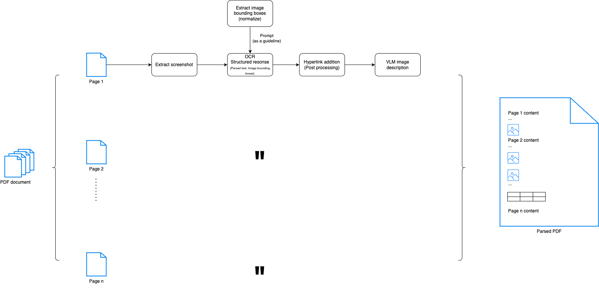

# llm_parse

> An open source package for parsing documents using an LLM.

## 🗂️ Architecture



✏️ You can edit this diagram directly using [draw.io](https://app.diagrams.net).

## 📦 Installation

```bash
pip install llm-parse
```

## 🧪 Quickstart Example

> *Coming soon!* Example usage of parsing a PDF using an LLM.

## 📚 Documentation

* [Developer Setup](docs/markdown/DEVELOPER_SETUP.md)
* [Project Commands](docs/markdown/PROJECT_COMMANDS.md)
* [Environment Setup](docs/markdown/ENVIRONMENT.md)
* [Contributing Guide](CONTRIBUTING.md)
* [Pre-commit Hooks](docs/markdown/PRECOMMIT.md)

---

## 🔗 Contributing

We welcome contributions! Please check the [contribution guide]().
